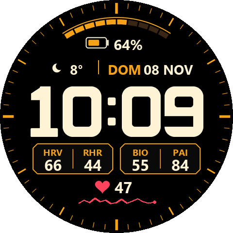
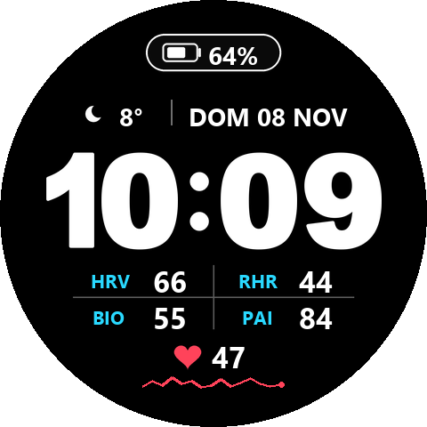
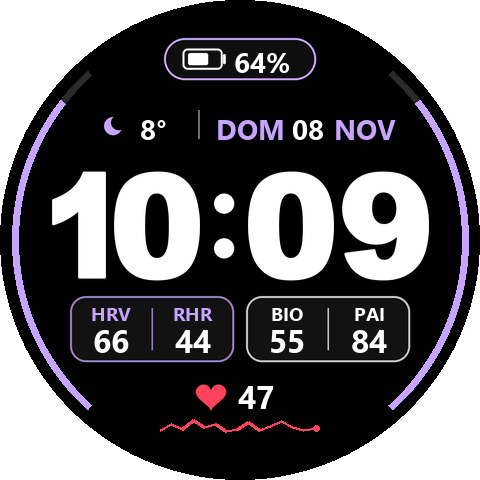

# Amazfit Watchfaces – TR3X series

Custom Zepp OS watchfaces for the **Amazfit T-Rex 3 Pro (48mm)**, written in JavaScript (`@zos/ui`, `@zos/sensor`) with assets generated in Python/Pillow.

| Watchface | Folder | Version |
|---|---|---|
| [TR3X Tactical](#tr3x-tactical) | [`wf-tactical-amber`](wf-tactical-amber) | 1.0.0 |
| [TR3X Minimal](#tr3x-minimal) | [`wf-minimal-grid`](wf-minimal-grid) | 1.0.0 |
| [TR3X Lavender](#tr3x-lavender) | [`wf-dual-lavender`](wf-dual-lavender) | 1.0.0 |

## How to install (QR)

1. In the **Zepp app**, enable Developer Mode: *Profile → Settings → About* and tap the Zepp logo 7 times.
2. Go to *Profile → your T-Rex 3 Pro → Developer Mode → Scan*.
3. Scan the QR of the watchface you want.

> [!NOTE]
> These are Zepp **preview QR codes**, and they expire about 7 days after they're generated. TR3X Tactical's QR is valid until **2026-11-20**. The other two were generated on 2026-11-12 and are valid until about **2026-11-19**. If a QR has expired, open an issue or build the face yourself (see [Build from source](#build-from-source)). TR3X Tactical has also been submitted to the Zepp store.

---

## TR3X Tactical

Tactical bezel dashboard: 60-tick ring, 10-segment battery arc, HRV / RHR / BioCharge / PAI in two beveled boxes, weather, live heart rate with sparkline.
**Customizable on the watch:** accent color (bezel, battery, boxes, labels) and minutes color.

 

## TR3X Minimal

Clean perimeter, rounded battery capsule, geometric rounded digits and an open 2×2 grid (HRV, RHR, BioCharge, PAI).
**Customizable on the watch:** grid label color and minutes color.

 

## TR3X Lavender

Thin side arcs for steps (left) and calories (right), battery capsule, date, and two rounded pills. The left pill (HRV | RHR) uses the theme color and the right pill (BIO | PAI) uses the minutes color.
**Customizable on the watch:** theme + left pill color, minutes + right pill color.

 

---

## Build from source

Requirements: Node.js 18+, [`@zeppos/zeus-cli`](https://docs.zepp.com/docs/guides/tools/cli/), Python 3 + Pillow.

```bash
npm i -g @zeppos/zeus-cli
cd wf-tactical-amber
python scripts/generate_assets.py        # regenerates PNG assets (+ preview in ./preview)
zeus login
zeus build   --target "Amazfit T-Rex 3 Pro (48mm)"
zeus preview --target "Amazfit T-Rex 3 Pro (48mm)"   # prints a fresh install QR
```

> [!TIP]
> If you build under your own Zepp developer account, change `appId` in `app.json` to an ID registered to you.

## Editing on the watch

Long-press the watchface → **Edit**. Each color selector has a caption that tells you which zone it changes.

## Credits & Acknowledgments

Special thanks to the author of [**BSF Dash**](https://www.reddit.com/r/amazfit/comments/1xqjy5j/bsf_dash/) (`u/Ariquitaun`).

While no source code was directly reused (BSF Dash was distributed as compiled QuickJS bytecode binary), analyzing its binary package served as a valuable technical reverse-engineering reference for deciphering undocumented Zepp OS 3.6+ / T-Rex 3 Pro hardware specifications:

### What was learned / referenced from BSF Dash:
* **Target and Manifest specifications (`app.json`)**: Exact device target IDs for the T-Rex 3 / Rocky platform (`10551552`, `10551553`, `10551555`) and the required health data permissions (`data:user.hd.pai`, `calorie`, `step`, etc.).
* **Undocumented Zepp OS APIs & Sensor constants**: IDs for metrics such as `ui.data_type.BIO_CHARGE`, `ui.data_type.HRV`, and `ui.data_type.PAI_WEEKLY`; structure for the undocumented `GRADKIENT_POLYLINE` widget for heart rate sparklines; and valid ranges for `WATCHFACE_EDIT_GROUP` (`type >= 100000`).
* **Outer Arc Geometry**: Clockwise radial sweep angles (`222°..318°` steps, `138°..42°` calories, `-54°..54°` battery) across the 224–226 px radius.
* **Standard iconography mappings**: The 29-state weather mapping for `IMG_LEVEL`.

### What was developed from scratch for the TR3X series:
* **100% of the JavaScript codebase (`watchface/index.js`)**: Clean modular JavaScript built on `@zos/ui` and `@zos/sensor` with full reactive lifecycle handling (`applyLayoutAndColors`, `syncEditOptions`, `WIDGET_DELEGATE.resume_call`) to enable instant hot-switching of styles and color themes without reload bugs.
* **Custom Typography & High-Visibility Digits**: Vector-crafted block digits (108 px tall) with dedicated high-visibility solid dimmed AOD numbers (avoiding unreadable thin hollow outlines), generated via Python/Pillow.
* **Sub-pixel Optical Centering**: Custom dynamic layout engine calculating glyph widths in real-time to center `HH:MM` perfectly regardless of narrow numerals (e.g., `1`).
* **True Neutral AMOLED Colorimetry**: Pure neutral gray palettes (`R === G === B`) designed from scratch to prevent AMOLED blue-tint quantization artifacts.
* **Heart Rate Sparkline Engine**: Custom temporal rolling window parser with moving average smoothing and widget-relative coordinate mapping.

In short, BSF Dash provided the foundational hardware compatibility and API map for the T-Rex 3 Pro, while the visual styling, typography, assets, and runtime JavaScript code were completely designed and implemented from scratch.

## Development & Skill Guide

For detailed technical rules, firmware quirks, lifecycle management (`WIDGET_DELEGATE`), sensor exceptions (RHR), and optical centering learned on this project:
- See the [Technical Development Guide](docs/DEVELOPMENT_GUIDE.md).
- Antigravity / Gemini CLI workspace skill: [zepp-os-watchface](.gemini/skills/zepp-os-watchface/SKILL.md).

