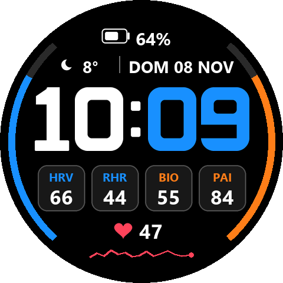
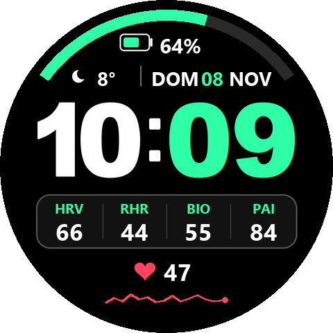

# Amazfit Watchfaces – TR3X series

Custom Zepp OS watchfaces for the **Amazfit T-Rex 3 Pro (48mm)**, written in JavaScript (`@zos/ui`, `@zos/sensor`) with assets generated in Python/Pillow.

| Watchface | Folder | Version |
|---|---|---|
| [TR3X Tactical](#tr3x-tactical) | [`wf-tactical-amber`](wf-tactical-amber) | 1.0.0 |
| [TR3X Minimal](#tr3x-minimal) | [`wf-minimal-grid`](wf-minimal-grid) | 1.0.0 |
| [TR3X Lavender](#tr3x-lavender) | [`wf-dual-lavender`](wf-dual-lavender) | 1.0.0 |
| [TR3X Dash](#tr3x-dash) | [`wf-dual-styles`](wf-dual-styles) | 1.2.0 |

## How to install (QR)

1. In the **Zepp app**, enable Developer Mode: *Profile → Settings → About* and tap the Zepp logo 7 times.
2. Go to *Profile → your T-Rex 3 Pro → Developer Mode → Scan*.
3. Scan the QR of the watchface you want.

> [!NOTE]
> These are Zepp **preview QR codes**, and they expire about 7 days after they're generated. TR3X Tactical's QR is valid until **2026-11-20**. The other three were generated on 2026-11-12 and are valid until about **2026-11-19**. If a QR has expired, open an issue or build the face yourself (see [Build from source](#build-from-source)). TR3X Tactical has also been submitted to the Zepp store.

---

## TR3X Tactical

Tactical bezel dashboard: 60-tick ring, 10-segment battery arc, HRV / RHR / BioCharge / PAI in two beveled boxes, weather, live heart rate with sparkline.
**Customizable on the watch:** accent color (bezel, battery, boxes, labels) and minutes color.

 

## TR3X Minimal

Clean perimeter, rounded battery capsule, geometric rounded digits and an open 2×2 grid (HRV, RHR, BioCharge, PAI).
**Customizable on the watch:** grid label color and minutes color.

 

## TR3X Lavender

Thin side arcs for steps (left) and calories (right), battery capsule, date, and two rounded pills. The left pill (HRV | RHR) uses the theme color and the right pill (BIO | PAI) uses the minutes color.
**Customizable on the watch:** theme + left pill color, minutes + right pill color.

 

## TR3X Dash

Two layouts you can switch between on the watch: **Style A** (side Steps/Calories arcs + 4 cards) and **Style B** (top battery arc + unified pill). Primary and secondary accent colors apply as soon as you leave the editor.

  

---

## Build from source

Requirements: Node.js 18+, [`@zeppos/zeus-cli`](https://docs.zepp.com/docs/guides/tools/cli/), Python 3 + Pillow.

```bash
npm i -g @zeppos/zeus-cli
cd wf-tactical-amber
python scripts/generate_assets.py        # regenerates PNG assets (+ preview in ./preview)
zeus login
zeus build   --target "Amazfit T-Rex 3 Pro (48mm)"
zeus preview --target "Amazfit T-Rex 3 Pro (48mm)"   # prints a fresh install QR
```

> [!TIP]
> If you build under your own Zepp developer account, change `appId` in `app.json` to an ID registered to you.

## Editing on the watch

Long-press the watchface → **Edit**. Each color selector has a caption that tells you which zone it changes.

## Development & Skill Guide

For detailed technical rules, firmware quirks, lifecycle management (`WIDGET_DELEGATE`), sensor exceptions (RHR), and optical centering learned on this project:
- See the [Technical Development Guide](docs/DEVELOPMENT_GUIDE.md).
- Antigravity / Gemini CLI workspace skill: [zepp-os-watchface](.gemini/skills/zepp-os-watchface/SKILL.md).

